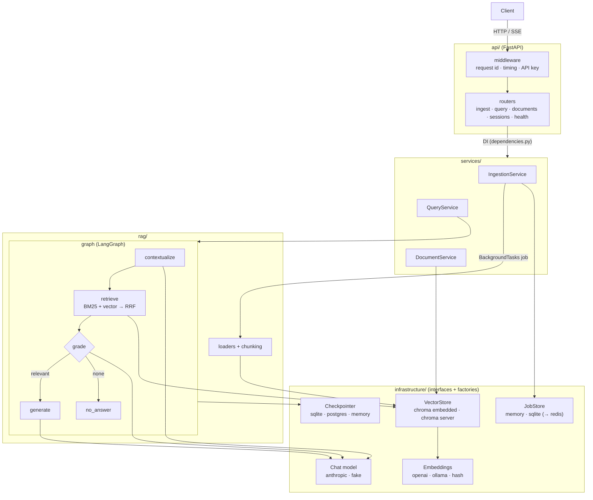

# rag-production

A production-style **Retrieval-Augmented Generation** service, organised in layers so
each backend can be swapped and the API can scale from a laptop to multiple replicas.

- **Ingestion**: PDF (pypdf), `.txt`/`.md`, web URLs (httpx + BeautifulSoup, SSRF guard) → recursive chunking with metadata (`source`, `page`, `chunk_index`, `chunk_id`) → content-hash dedupe + incremental re-sync. Runs as a **background job** with a pollable status.
- **Hybrid retrieval**: BM25 + vector search fused with **Reciprocal Rank Fusion**.
- **LangGraph pipeline**: contextualize → retrieve → grade → generate / no_answer, with a pluggable **checkpointer** for per-session memory.
- **Generation**: `ChatAnthropic` (default `claude-sonnet-5-5`), answers only from context with `[n]` citations, says "I don't know" otherwise.
- **Pluggable backends** (env-selected): embeddings (OpenAI / Ollama / offline hash), vector store (embedded Chroma / **Chroma server**), checkpointer (SQLite / Postgres / memory), job store (memory / SQLite).
- **API**: FastAPI, SSE streaming, optional API key, JSON logs with request ids, timing headers.

## Project layout

```
rag-production/
├── src/rag_app/
│   ├── main.py                 # FastAPI app factory (entrypoint: rag_app.main:app)
│   ├── container.py            # composition root: builds backends + services from Settings
│   ├── api/                    # HTTP layer
│   │   ├── routers/            #   health.py ingest.py query.py documents.py sessions.py
│   │   ├── schemas.py          #   request/response models
│   │   ├── dependencies.py     #   DI: services from the container, API-key guard
│   │   └── middleware.py       #   request id, timing, access log, last-resort 500
│   ├── core/                   # cross-cutting: config.py logging.py security.py errors.py
│   ├── domain/                 # shared models (models.py) + pure text helpers (text.py)
│   ├── services/               # use-cases: ingestion_service.py query_service.py document_service.py
│   ├── rag/                    # RAG logic (no HTTP, no concrete backends)
│   │   ├── loaders/            #   pdf.py text.py web.py + extension registry
│   │   ├── chunking.py         #   recursive splitter + content-hash dedupe
│   │   ├── retrieval/          #   rrf.py bm25.py hybrid.py
│   │   ├── grading.py          #   heuristic / LLM relevance filter
│   │   ├── prompts.py
│   │   └── graph/              #   state.py builder.py nodes/{contextualize,retrieve,grade,generate}.py
│   └── infrastructure/         # swappable backends: interface + factory per concern
│       ├── embeddings/         #   openai | ollama | hash
│       ├── llm/                #   anthropic | fake (offline)
│       ├── vectorstore/        #   base.py (Protocol) + chroma.py (embedded | http)
│       ├── checkpointer/       #   sqlite | postgres (optional extra) | memory
│       └── jobs/               #   base.py (Protocol) + memory.py | sqlite.py
├── tests/
│   ├── support.py, conftest.py # fakes (InMemoryVectorStore, fake LLM) + fixtures
│   ├── unit/                   # core/ domain/ rag/ infrastructure/ services/ (mirrors the package)
│   └── integration/            # API via TestClient, embedded Chroma, real local Chroma server
├── scripts/ingest_dir.py       # bulk ingest CLI (same container as the API)
├── data/northwind_handbook.md  # demo document
├── Dockerfile  docker-compose.yml  Makefile  .env.example  pyproject.toml  uv.lock
```

### Why each layer

| Layer | Responsibility | Depends on |
|---|---|---|
| `api/` | HTTP only: parse/validate requests, call a service, shape the response, auth, SSE. No business logic. | services, domain, core |
| `services/` | Use-cases ("ingest these files as a job", "answer this question"). Framework-agnostic, so the CLI and a future queue worker reuse them. | rag, infrastructure *interfaces*, domain |
| `rag/` | The RAG algorithm: loaders, chunking, hybrid retrieval, grading, prompts, graph nodes. Talks to backends only through interfaces. | infrastructure interfaces, domain |
| `infrastructure/` | Concrete backends behind small interfaces + `build_*` factories chosen by env. Swapping Chroma for pgvector touches only this folder. | core, domain |
| `domain/` | Pydantic models and pure helpers shared by all layers (no I/O). | — |
| `core/` | Settings, logging, security, error types. | — |
| `container.py` | The single place that wires concrete classes together (and where tests inject fakes). | everything |

Dependencies point inwards/downwards only; nothing in `rag/` or `services/` imports FastAPI or a concrete backend.

## Architecture



## Setup

Requires [uv](https://docs.astral.sh/uv/) and Python 3.13.

```bash
uv python install 3.13        # if needed
uv sync                       # .venv from uv.lock (installs rag_app in editable mode)
cp .env.example .env          # fill in ANTHROPIC_API_KEY (+ OPENAI_API_KEY, or EMBEDDINGS_PROVIDER=ollama/hash)
```

Key settings (all in `.env.example`):

| Variable | Default | Notes |
|---|---|---|
| `LLM_PROVIDER` / `LLM_MODEL` | `anthropic` / `claude-sonnet-5-5` | `fake` = offline deterministic model |
| `EMBEDDINGS_PROVIDER` | `openai` | `ollama`, `hash` (offline, lexical only) |
| `CHROMA_HOST` / `CHROMA_PORT` | unset / `8000` | set → Chroma **server** mode (multi-worker safe) |
| `CHECKPOINTER_BACKEND` | `sqlite` | `postgres` (+ `POSTGRES_URL`, `uv sync --extra postgres`), `memory` |
| `JOB_STORE_BACKEND` | `memory` | `sqlite` when running several workers on one host |
| `GRADER_MODE` | `llm` | `heuristic` (no LLM call) or `none` |
| `API_KEY` | unset | when set, everything except `/health` needs `X-API-Key` |

Changing the embedding model needs a new `COLLECTION_NAME` (the app refuses to mix vector spaces).

## Run

```bash
make run                                   # = uv run uvicorn rag_app.main:app --reload
# multi-worker (two terminals):
make chroma                                # local Chroma server on :8001 (bundled `chroma` CLI)
make run-workers WORKERS=4                 # CHROMA_HOST=127.0.0.1 ... uvicorn --workers 4
# bulk ingest without the API:
uv run python scripts/ingest_dir.py data/ --recursive
# docker: api (2 workers) + Chroma server
docker compose up --build -d
```

No `make`? Every target is a one-line `uv run ...` command (see `Makefile`).

## API & curl examples

```bash
curl -s localhost:8000/health

# Ingest (202 Accepted + job id), then poll the job
curl -s -X POST localhost:8000/ingest/files -F "files=@data/northwind_handbook.md"
# → {"job_id":"4f1c...","status":"queued","status_url":"/ingest/jobs/4f1c...","accepted":["northwind_handbook.md"],"rejected":[]}
curl -s localhost:8000/ingest/jobs/4f1c...
# → {"status":"succeeded","results":[{"source":"northwind_handbook.md","status":"ok","chunks":7,"added":7,...}],...}

curl -s -X POST localhost:8000/ingest/url -H 'Content-Type: application/json' -d '{"url":"https://example.com/"}'

# Ask (session_id = conversation memory; omit to start a new one)
curl -s -X POST localhost:8000/query -H 'Content-Type: application/json' \
  -d '{"question":"How long does the Atlas-7 battery last, and how long does it take to recharge?","session_id":"demo-1"}'

# Stream tokens (SSE): meta → status → token* → sources → done
curl -N -X POST localhost:8000/query/stream -H 'Content-Type: application/json' \
  -d '{"question":"What does Premium support include?","session_id":"demo-1"}'

curl -s localhost:8000/documents
curl -s -X DELETE localhost:8000/documents/northwind_handbook.md
curl -s localhost:8000/sessions/demo-1/history
curl -s localhost:8000/documents -H "X-API-Key: $API_KEY"     # when API_KEY is set
```

Job statuses: `queued` → `running` → `succeeded` | `partial` (some inputs failed) | `failed`. Errors are JSON `{"error","detail","request_id"}`; every response carries `X-Request-ID` and `X-Process-Time-Ms`.

## Tests

```bash
make test          # or: uv run pytest            (all offline)
make test-unit     # tests/unit       - pure logic, InMemoryVectorStore + FakeChatModel
make test-integration  # tests/integration - FastAPI TestClient, embedded Chroma, local Chroma server
```

The Chroma-server test (`-m chroma_server`) starts the `chroma` CLI bundled with `chromadb` on a free local port and runs two app instances against it (simulating two workers); it is skipped automatically if the CLI can't start.

## Scaling path

**1. Local / single process (default)**: embedded Chroma in `DATA_DIR`, SQLite checkpointer, in-memory job store, one uvicorn worker. Zero infrastructure.

**2. One host, many workers**: run a Chroma server and point workers at it.
`CHROMA_HOST=... JOB_STORE_BACKEND=sqlite uvicorn rag_app.main:app --workers N` (or `docker compose up`).
Chroma handles concurrent access; SQLite (WAL) checkpoints and jobs are shared through the common `DATA_DIR`.

**3. Many replicas / hosts**: every piece of state moves to a network service, and API replicas sit behind a load balancer:
- vector store → Chroma server/Cloud, or **pgvector** (add `infrastructure/vectorstore/pgvector.py` implementing `VectorStore`)
- checkpointer → **Postgres** (`CHECKPOINTER_BACKEND=postgres`, `uv sync --extra postgres`)
- jobs → **Redis** job store + a real queue (Celery/RQ/Arq/SQS) running `IngestionService.run_*_job` in separate worker processes instead of `BackgroundTasks`
- BM25 → OpenSearch/Elasticsearch, or native hybrid search (Postgres `tsvector` + pgvector, Qdrant, Weaviate)

**Things to know about the current design**
- **BM25 is per process.** Each worker holds its own in-memory index built from all chunks. The vector store keeps a `revision` token that changes on every write, and workers check it at most every `BM25_REFRESH_S` seconds, so writes made by other workers or replicas show up within that window. Memory use is (corpus size × workers), so this works up to roughly 10^5 chunks. Past that, use a search engine.
- **BackgroundTasks run inside the API process.** A crash or redeploy loses the job that is running, and heavy ingestion competes with queries for CPU. A queue fixes both.
- **The memory job store is per process.** With several workers, use the SQLite store (one host) or Redis (many hosts) so any worker can answer `GET /ingest/jobs/{id}`.
- **Re-ingesting the same source concurrently from two workers isn't locked across processes.** Last write wins. Add a distributed lock (for example Redis or a Postgres advisory lock) if that matters.

## Production notes

**Evaluation**
- Build a golden set of (question, expected answer, expected sources).
- Track retrieval metrics (recall@k, MRR) separately from answer metrics (faithfulness, relevance, citation precision). Ragas, DeepEval and LangSmith evals all work here.
- Use that set to tune `CHUNK_SIZE`, `RRF_K`, `VECTOR_K`, `BM25_K`, `RETRIEVAL_K` and the grader mode.
- Prompts live in `rag/prompts.py`, so they can be versioned.

**Observability**
- The JSON logs include `request_id`, latencies, retrieval counts, grader kept/retrieved, rewritten queries and job outcomes.
- For per-node traces and token cost, add LangSmith (`LANGSMITH_TRACING=true`) or OpenTelemetry.
- Export Prometheus metrics for p95 latency, error rate, LLM latency, tokens and ingestion throughput.

**Security**
- Set `API_KEY` or put an auth gateway in front.
- Restrict `CORS_ORIGINS`.
- Keep `ALLOW_PRIVATE_URLS=false` (the SSRF guard).
- Secrets belong in a secret manager. The image runs as a non-root user with a read-only root filesystem in compose.
